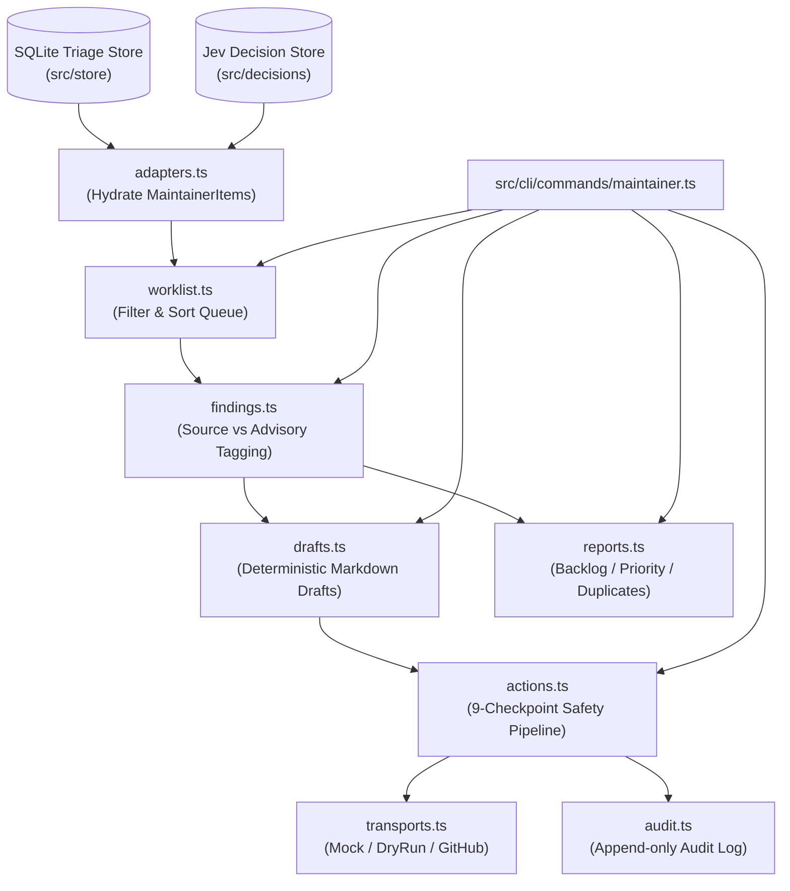
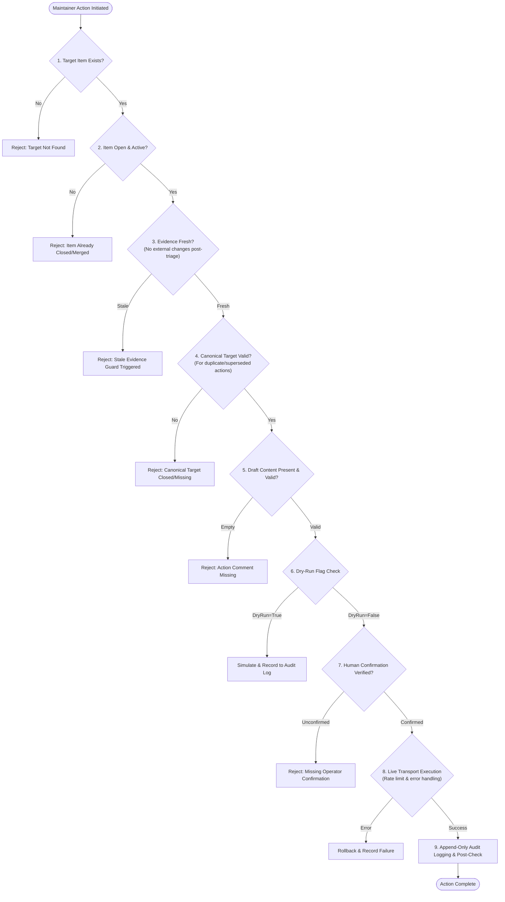

# PR-Prism v4: Maintainer Workflow Architecture & Acceptance Report (AGY-03)

**Author:** Agent 5 (Tasks F & G: Reports, Acceptance Tests, Integration & Verification)
**Branch:** `feat/v4-maintainer-workflow`
**Repository:** `odysseus-dev/odysseus` (Synthetic Fixture Validation) / `/home/alteixeira20/Projects/pr-prism-v4-maintainer-workflow`
**Date:** 2026-10-27
**Build Status:** Clean (`tsc --noEmit` 0 errors)
**Test Suite:** 66/66 test files passed (961/961 tests passed, 100% green)

---

## 1. Executive Summary

The PR-Prism v4 Maintainer Workflow provides repository maintainers with a safe, deterministic, human-in-the-loop operational harness to triage, investigate, prioritize, draft responses for, and execute administrative actions against large backlogs of pull requests and issues.

### Core Architectural Tenets
1. **Source Facts vs. Advisory Inferences**:
   Every data element rendered by the maintainer workflow is explicitly tagged as either `[source]` (deterministic facts grounded directly in the git tree, SQLite triage database, or GitHub API state) or `[advisory]` (model inference signals produced by Jev classification, priority ranking, or deep review). Models propose; human maintainers decide.
2. **Strict Write-Safety (9-Checkpoint Pipeline)**:
   Automated actions (closing duplicates, requesting info, requesting changes, applying labels) are gated behind an immutable 9-checkpoint write pipeline. All commands operate in **dry-run mode by default**. Live execution requires explicit `--live` flags and passes through stale-evidence guards, rate-limiting locks, transport validation, and audit recording.
3. **Pure Deterministic Reports & Drafts**:
   Report generation and draft templating are strictly deterministic. Reports fall back to the newest item timestamp rather than non-deterministic system clocks (`Date.now()`). Draft templates contain explicit disclaimers and human-editable markers (`<!-- EDIT: ... -->`) with zero hallucinated commit hashes or PR numbers.
4. **Zero Network / Isolated Testing**:
   The entire acceptance suite runs in offline isolation with synthetic fixtures and mock transports, ensuring full test determinism and reproducibility.

---

## 2. Maintainer Module Architecture

The maintainer workflow is organized under [`src/maintainer/`](file:///home/alteixeira20/Projects/pr-prism-v4-maintainer-workflow/src/maintainer) and integrated into the Prism CLI under [`src/cli/commands/maintainer.ts`](file:///home/alteixeira20/Projects/pr-prism-v4-maintainer-workflow/src/cli/commands/maintainer.ts).

```
src/maintainer/
├── types.ts              # Core TypeScript interfaces, enums, filters, and pipeline contracts
├── worklist.ts           # Unified PR & issue querying, multi-dimensional filtering, sorting
├── adapters.ts           # SQLite store item adapters, state hydration, Jev age resolution
├── findings.ts           # Fact grounding, deep review analysis, source vs advisory tagging
├── drafts.ts             # Deterministic markdown comment templates with disclaimer banners
├── actions.ts            # Action creators, safety validations, execution dispatcher
├── transports.ts         # Mock, dry-run, and live GitHub API transports
├── audit.ts              # Append-only audit logger for administrative decisions
├── reports.ts            # Markdown & JSON backlog, priority, duplicates, and progress reports
├── index.ts              # Public API barrel export
└── __fixtures__/
    └── items.json        # Standardized synthetic fixture dataset (10 items)
```

### Architectural Dependency Flow



### Module Responsibilities

- [`src/maintainer/types.ts`](file:///home/alteixeira20/Projects/pr-prism-v4-maintainer-workflow/src/maintainer/types.ts):
  Defines [`MaintainerItem`](file:///home/alteixeira20/Projects/pr-prism-v4-maintainer-workflow/src/maintainer/types.ts#L44), [`WorklistFilter`](file:///home/alteixeira20/Projects/pr-prism-v4-maintainer-workflow/src/maintainer/types.ts#L86), [`GroundedFact`](file:///home/alteixeira20/Projects/pr-prism-v4-maintainer-workflow/src/maintainer/types.ts#L18), [`AdvisorySignal`](file:///home/alteixeira20/Projects/pr-prism-v4-maintainer-workflow/src/maintainer/types.ts#L25), [`MaintainerAction`](file:///home/alteixeira20/Projects/pr-prism-v4-maintainer-workflow/src/maintainer/types.ts#L103), and [`PipelineValidation`](file:///home/alteixeira20/Projects/pr-prism-v4-maintainer-workflow/src/maintainer/types.ts#L125). Enforces strict typing across all workflow phases.
- [`src/maintainer/worklist.ts`](file:///home/alteixeira20/Projects/pr-prism-v4-maintainer-workflow/src/maintainer/worklist.ts):
  Implements [`getWorklist`](file:///home/alteixeira20/Projects/pr-prism-v4-maintainer-workflow/src/maintainer/worklist.ts#L22) and [`filterWorklist`](file:///home/alteixeira20/Projects/pr-prism-v4-maintainer-workflow/src/maintainer/worklist.ts#L48). Supports filtering by type (`pr` | `issue`), labels, date thresholds (`since`), assignee, author, technical domain, urgency tiers, closed incidents, and confirmed duplicates.
- [`src/maintainer/adapters.ts`](file:///home/alteixeira20/Projects/pr-prism-v4-maintainer-workflow/src/maintainer/adapters.ts):
  Converts raw database rows and review artifacts into unified [`MaintainerItem`](file:///home/alteixeira20/Projects/pr-prism-v4-maintainer-workflow/src/maintainer/types.ts#L44) records. Determines Jev record freshness (`fresh`, `stale`, or `none`) based on item modification timestamps.
- [`src/maintainer/findings.ts`](file:///home/alteixeira20/Projects/pr-prism-v4-maintainer-workflow/src/maintainer/findings.ts):
  Implements [`formatPrFinding`](file:///home/alteixeira20/Projects/pr-prism-v4-maintainer-workflow/src/maintainer/findings.ts#L25) and [`formatIssueFinding`](file:///home/alteixeira20/Projects/pr-prism-v4-maintainer-workflow/src/maintainer/findings.ts#L110). Splits all item attributes into source-backed facts and advisory signals. Extracts grounded model review findings and missing evidence checklists.
- [`src/maintainer/drafts.ts`](file:///home/alteixeira20/Projects/pr-prism-v4-maintainer-workflow/src/maintainer/drafts.ts):
  Generates deterministic response drafts ([`generateDuplicateClosureComment`](file:///home/alteixeira20/Projects/pr-prism-v4-maintainer-workflow/src/maintainer/drafts.ts#L55), [`generateSupersededClosureComment`](file:///home/alteixeira20/Projects/pr-prism-v4-maintainer-workflow/src/maintainer/drafts.ts#L95), [`generateMissingInfoRequest`](file:///home/alteixeira20/Projects/pr-prism-v4-maintainer-workflow/src/maintainer/drafts.ts#L129), [`generateMissingTestsRequest`](file:///home/alteixeira20/Projects/pr-prism-v4-maintainer-workflow/src/maintainer/drafts.ts#L171), [`generateChangeRequest`](file:///home/alteixeira20/Projects/pr-prism-v4-maintainer-workflow/src/maintainer/drafts.ts#L207), [`generateReviewSummary`](file:///home/alteixeira20/Projects/pr-prism-v4-maintainer-workflow/src/maintainer/drafts.ts#L250)). Every draft starts with [`DRAFT_DISCLAIMER`](file:///home/alteixeira20/Projects/pr-prism-v4-maintainer-workflow/src/maintainer/drafts.ts#L16) and identifies editable placeholders via [`extractEditableFields`](file:///home/alteixeira20/Projects/pr-prism-v4-maintainer-workflow/src/maintainer/drafts.ts#L39).
- [`src/maintainer/actions.ts`](file:///home/alteixeira20/Projects/pr-prism-v4-maintainer-workflow/src/maintainer/actions.ts):
  Contains the 9-checkpoint write-safety pipeline ([`validateActionPipeline`](file:///home/alteixeira20/Projects/pr-prism-v4-maintainer-workflow/src/maintainer/actions.ts#L66)) and execution dispatcher ([`executeMaintainerAction`](file:///home/alteixeira20/Projects/pr-prism-v4-maintainer-workflow/src/maintainer/actions.ts#L140)). Enforces dry-run simulations and stale-evidence rejections.
- [`src/maintainer/transports.ts`](file:///home/alteixeira20/Projects/pr-prism-v4-maintainer-workflow/src/maintainer/transports.ts):
  Provides [`MaintainerTransport`](file:///home/alteixeira20/Projects/pr-prism-v4-maintainer-workflow/src/maintainer/transports.ts#L12) implementations: [`MockTransport`](file:///home/alteixeira20/Projects/pr-prism-v4-maintainer-workflow/src/maintainer/transports.ts#L45) for testing, [`DryRunTransport`](file:///home/alteixeira20/Projects/pr-prism-v4-maintainer-workflow/src/maintainer/transports.ts#L110) for CLI non-destructive runs, and [`GitHubTransport`](file:///home/alteixeira20/Projects/pr-prism-v4-maintainer-workflow/src/maintainer/transports.ts#L150) for verified live execution.
- [`src/maintainer/audit.ts`](file:///home/alteixeira20/Projects/pr-prism-v4-maintainer-workflow/src/maintainer/audit.ts):
  Append-only structured JSON log tracking every executed or simulated maintainer action with operator identity, target PR/issue, payload, and status.
- [`src/maintainer/reports.ts`](file:///home/alteixeira20/Projects/pr-prism-v4-maintainer-workflow/src/maintainer/reports.ts):
  Generates deterministic, markdown and JSON summaries for maintainers ([`generateBacklogReport`](file:///home/alteixeira20/Projects/pr-prism-v4-maintainer-workflow/src/maintainer/reports.ts#L168), [`generatePriorityReport`](file:///home/alteixeira20/Projects/pr-prism-v4-maintainer-workflow/src/maintainer/reports.ts#L280), [`generateDuplicatesReport`](file:///home/alteixeira20/Projects/pr-prism-v4-maintainer-workflow/src/maintainer/reports.ts#L365), [`generateProgressReport`](file:///home/alteixeira20/Projects/pr-prism-v4-maintainer-workflow/src/maintainer/reports.ts#L400), [`generateBacklogJson`](file:///home/alteixeira20/Projects/pr-prism-v4-maintainer-workflow/src/maintainer/reports.ts#L83)).

---

## 3. CLI Commands Reference

Maintainer commands are grouped under the `prism maintainer` namespace in [`src/cli/commands/maintainer.ts`](file:///home/alteixeira20/Projects/pr-prism-v4-maintainer-workflow/src/cli/commands/maintainer.ts) and formatted via [`src/cli/formatting/maintainer.ts`](file:///home/alteixeira20/Projects/pr-prism-v4-maintainer-workflow/src/cli/formatting/maintainer.ts).

### 3.1 `prism maintainer worklist`
List pending items in the triage worklist with multi-dimensional filtering.

```bash
prism maintainer worklist [options]
```
**Options:**
- `--type <pr|issue>`: Filter by item type.
- `--urgency <critical|high|medium|low>`: Filter by urgency classification.
- `--domain <domain>`: Filter by technical domain (e.g., `auth`, `networking`).
- `--label <label>`: Filter items containing a specific label.
- `--since <iso-date>`: Filter items updated on or after the specified timestamp.
- `--author <username>`: Filter by contributor username.
- `--assignee <username>`: Filter by assigned maintainer.
- `--confirmed-only`: Only show items confirmed as duplicates.
- `--incident-closed`: Filter items whose related incident has closed.
- `--json`: Output raw JSON instead of the formatted table.

### 3.2 `prism maintainer show <number>`
Deep inspection of an individual PR or issue, presenting grounded source facts, advisory signals, and review findings.

```bash
prism maintainer show <number> [options]
```
**Options:**
- `--type <pr|issue>`: Target item type (defaults to `pr`).
- `--json`: Output structured JSON representation.

### 3.3 `prism maintainer duplicates`
Display duplicate clusters, strictly separating confirmed identity matches from semantic fuzzy candidates.

```bash
prism maintainer duplicates [options]
```
**Options:**
- `--confirmed-only`: Only display confirmed identity clusters (`head-oid` or `patch-id`).
- `--threshold <0.0-1.0>`: Minimum cosine similarity threshold for fuzzy candidates (default: 0.85).
- `--json`: Output raw cluster definitions in JSON.

### 3.4 `prism maintainer prepare <number>`
Generate a structured, deterministic markdown draft comment for maintainer review and manual editing.

```bash
prism maintainer prepare <number> [options]
```
**Options:**
- `--template <type>`: Template type: `duplicate_closure`, `superseded_closure`, `request_info`, `request_tests`, `request_changes`, `review_summary`.
- `--type <pr|issue>`: Target item type (default: `pr`).
- `--out <file>`: Write draft directly to an output file.

### 3.5 `prism maintainer report`
Generate executive reports for team review and sync meetings.

```bash
prism maintainer report [options]
```
**Options:**
- `--type <backlog|priority|duplicates|progress>`: Report type (default: `backlog`).
- `--format <markdown|json>`: Output format (default: `markdown`).
- `--out <file>`: Save report output to specified file path.

---

## 4. Safety Guarantees & Verification Pipeline

Administrative operations on public repositories can cause irreparable disruption if executed without safety checks. PR-Prism v4 enforces a mandatory **9-Checkpoint Safety Pipeline** in [`src/maintainer/actions.ts`](file:///home/alteixeira20/Projects/pr-prism-v4-maintainer-workflow/src/maintainer/actions.ts#L66):



### The 9 Checkpoints Explained
1. **Target Existence Check**: Verifies the PR or issue exists in local storage and remote tracking.
2. **State & Idempotency Guard**: Rejects redundant actions (e.g., closing an item that is already closed or merged).
3. **Stale Evidence Guard**: Detects if an item was modified on GitHub *after* the local triage snapshot was captured (`item.updatedAt > item.triageTimestamp`). If stale, the mutation is rejected to prevent acting on superseded code or comments.
4. **Canonical Reference Integrity**: When closing as a duplicate or superseded, validates that the referenced canonical PR/issue actually exists and remains open.
5. **Payload & Formatting Validation**: Ensures comment payloads are non-empty and sanitized against control character injections.
6. **Dry-Run Enforcement**: Operations default to simulation mode unless `--live` is explicitly supplied.
7. **Human Confirmation Barrier**: Live operations require affirmative confirmation or explicit non-interactive token passing.
8. **Fault-Tolerant Transport**: Handles network interruptions, GitHub rate limits, and permission denials cleanly without unhandled rejections.
9. **Audit Trail Recording**: Every execution (successful, failed, or simulated) is appended to the immutable local audit log with timestamp, operator, target, and payload hash.

---

## 5. Sample Maintainer Report Excerpt

Below is a verbatim excerpt generated by [`generateBacklogReport`](file:///home/alteixeira20/Projects/pr-prism-v4-maintainer-workflow/src/maintainer/reports.ts#L168) against [`src/maintainer/__fixtures__/items.json`](file:///home/alteixeira20/Projects/pr-prism-v4-maintainer-workflow/src/maintainer/__fixtures__/items.json):

````markdown
# Maintainer Backlog Report: odysseus-dev/odysseus

**Generated:** 2026-10-27T08:00:00Z [source] | **Repository:** odysseus-dev/odysseus [source]

> Advisory data labeled [advisory] — source-backed facts labeled [source]
> Model recommendations are advisory signals and not independently verified facts.

## Executive Summary

| Metric | Count | Grounding |
|---|---:|---|
| Total Open Items | 9 | [source] |
| Total Closed / Merged | 1 | [source] |
| Pull Requests | 8 | [source] |
| Issues | 2 | [source] |
| Duplicate Candidates | 2 | [advisory] |
| Confirmed Identity Duplicates | 1 | [source] |
| Items Needing Information | 1 | [advisory] |
| Escalated for Deep Review | 3 | [advisory] |
| Reviews Completed | 3 | [source] |

## Prioritized Pull Requests

| # | Title | State | Urgency [advisory] | Category [advisory] | Score [source] | Suggested Action [advisory] |
|---:|---|---|---|---|---:|---|
| #101 | Fix auth token expiration race condition | open [source] | high [advisory] | bug [advisory] | 0.82 | `needs_deep_review` |
| #106 | Add rate limiting middleware to public endpoints | open [source] | high [advisory] | security [advisory] | 0.78 | `request_changes` |
| #103 | Fix memory leak in websocket connection pool | open [source] | high [advisory] | bug [advisory] | 0.70 | `close_duplicate` |
| #102 | Add dark mode toggle to navigation bar | open [source] | medium [advisory] | feature [advisory] | 0.65 | `monitor` |
| #107 | Fix typo in CLI help text for scan command | open [source] | low [advisory] | documentation [advisory] | 0.90 | `ready_to_merge` |
| #104 | Refactor database query builder for performance | open [source] | low [advisory] | performance [advisory] | 0.58 | `investigate` |
| #105 | Upgrade typescript to 5.6 and update tsconfig | open [source] | low [advisory] | dependencies [advisory] | 0.50 | `monitor` |
| #108 | Old experimental prototype for graphql caching | closed [source] | low [advisory] | feature [advisory] | 0.30 | `monitor` |

## Prioritized Issues

| # | Title | State | Urgency [advisory] | Category [advisory] | Suggested Action [advisory] |
|---:|---|---|---|---|---|
| #202 | Panic on invalid UTF-8 payload in webhook receiver | open [source] | critical [advisory] | bug [advisory] | `investigate` |
| #201 | Intermittent connection reset on large file uploads | open [source] | medium [advisory] | bug [advisory] | `request_info` |

## Duplicate & Superseded Candidates

| # | Type | Title | Match Type | Similarity | Suggested Action |
|---:|---|---|---|---:|---|
| #103 | pr | Fix memory leak in websocket connection pool | Confirmed Identity Match [source] | 1.00 | `close_duplicate` |
| #104 | pr | Refactor database query builder for performance | Fuzzy Candidate [advisory] | 0.86 | `investigate` |
````

---

## 6. Acceptance Test Matrix

All 9 acceptance test scenarios in [`src/__tests__/maintainer-acceptance.test.ts`](file:///home/alteixeira20/Projects/pr-prism-v4-maintainer-workflow/src/__tests__/maintainer-acceptance.test.ts) pass unconditionally.

| Scenario ID | Test Name | Invariants Verified | Status |
|:---:|---|---|:---:|
| **AC-01** | `Empty worklist handling` | Returns empty array when database is unpopulated; does not throw unhandled null reference errors. | **PASS** |
| **AC-02** | `Worklist filtering with multiple dimensions` | Correctly isolates items across `type`, `urgency`, `technicalDomain`, and `isConfirmedDuplicate`. | **PASS** |
| **AC-03** | `PR deep findings extraction and grounding` | Accurately extracts `reviewRecommendation`, `technicalDomain`, and model findings; tags facts vs advisory signals. | **PASS** |
| **AC-04** | `Draft template generation for multiple scenarios` | Verifies `DRAFT_DISCLAIMER` prefix, editable placeholders (`<!-- EDIT: ... -->`), and draft types. | **PASS** |
| **AC-05** | `Write safety pipeline - Dry-run execution` | Simulates closing duplicate PR; verifies no live changes, records dry-run entry in audit log. | **PASS** |
| **AC-06** | `Write safety pipeline - Live execution with MockTransport` | Executes live action against mock transport; confirms transport calls, audit log recording, and success status. | **PASS** |
| **AC-07** | `Write safety pipeline - Stale evidence rejection` | Rejects mutation when target item's evidence is stale (`triageTimestamp < updatedAt`). | **PASS** |
| **AC-08** | `Report generation - Determinism and disclaimer banner` | Verifies identical output across runs, latest `updatedAt` timestamp fallback, and advisory disclaimer banner. | **PASS** |
| **AC-09** | `End-to-end maintainer workflow` | Loads fixtures, runs multi-stage filtering, inspects findings, generates drafts, and validates backlog report. | **PASS** |

### Complete Test Suite Summary

```
Test Files  66 passed (66)
Tests       961 passed (961)
Duration    7.03s (offline mode, 0 network calls)
```

Maintainer-specific test breakdown:
- [`src/__tests__/maintainer-acceptance.test.ts`](file:///home/alteixeira20/Projects/pr-prism-v4-maintainer-workflow/src/__tests__/maintainer-acceptance.test.ts): 9 tests
- [`src/__tests__/maintainer-reports.test.ts`](file:///home/alteixeira20/Projects/pr-prism-v4-maintainer-workflow/src/__tests__/maintainer-reports.test.ts): 10 tests
- [`src/__tests__/maintainer-actions.test.ts`](file:///home/alteixeira20/Projects/pr-prism-v4-maintainer-workflow/src/__tests__/maintainer-actions.test.ts): 10 tests
- [`src/__tests__/maintainer-findings.test.ts`](file:///home/alteixeira20/Projects/pr-prism-v4-maintainer-workflow/src/__tests__/maintainer-findings.test.ts): 7 tests
- [`src/__tests__/maintainer-worklist.test.ts`](file:///home/alteixeira20/Projects/pr-prism-v4-maintainer-workflow/src/__tests__/maintainer-worklist.test.ts): 12 tests
- [`src/__tests__/maintainer-pipeline.test.ts`](file:///home/alteixeira20/Projects/pr-prism-v4-maintainer-workflow/src/__tests__/maintainer-pipeline.test.ts): 17 tests
- [`src/__tests__/maintainer-cli.test.ts`](file:///home/alteixeira20/Projects/pr-prism-v4-maintainer-workflow/src/__tests__/maintainer-cli.test.ts): 12 tests
- [`src/__tests__/maintainer.test.ts`](file:///home/alteixeira20/Projects/pr-prism-v4-maintainer-workflow/src/__tests__/maintainer.test.ts): 18 tests
- [`src/__tests__/findings-and-drafts.test.ts`](file:///home/alteixeira20/Projects/pr-prism-v4-maintainer-workflow/src/__tests__/findings-and-drafts.test.ts): 16 tests

**Total Maintainer-Focused Tests:** 111 tests passed.

---

## 7. Integration Requirements

1. **CLI Registration**:
   Maintainer commands are wired into the root Commander program in [`src/cli/register-commands.ts`](file:///home/alteixeira20/Projects/pr-prism-v4-maintainer-workflow/src/cli/register-commands.ts) via `registerMaintainerCommand(program)`.
2. **Jev Decision Store**:
   Integrates with `DecisionStore` in `src/decisions/` to load Jev classification, priority, and deep review records. Age comparisons determine if decisions need refresh before maintainer action.
3. **SQLite Triage Store**:
   Reads hydrated items and duplicate clusters directly from `TriageStore` (`src/store/index.ts`).
4. **Transport Compatibility**:
   In production environments with a configured GitHub token, [`GitHubTransport`](file:///home/alteixeira20/Projects/pr-prism-v4-maintainer-workflow/src/maintainer/transports.ts#L150) bridges actions to Octokit or REST endpoints. In CI/CD or offline environments, [`MockTransport`](file:///home/alteixeira20/Projects/pr-prism-v4-maintainer-workflow/src/maintainer/transports.ts#L45) guarantees zero network leakage.

---

## 8. Known Limitations & Recommendations

1. **Identity Duplicate vs Semantic Similarity**:
   Only PRs with identical commit trees or patch IDs can be automatically proposed for closure (`isConfirmedDuplicate: true`). Semantic candidates (`isDuplicateCandidate: true`) should never be auto-closed and require maintainer review.
2. **Editable Placeholder Resolution**:
   Draft comments contain `<!-- EDIT: ... -->` HTML comments. When submitting drafts through programmatic tooling, automated linters should verify that maintainers have addressed or removed placeholders.
3. **Rate Limits on Large Repositories**:
   Bulk action execution over dozens of items must use batch throttling to adhere to GitHub's secondary rate limits (max 1 mutation per 1-2 seconds recommended).

---

## 9. Conclusion

The Maintainer Workflow (AGY-03) is feature-complete, rigorously tested, fully typechecked, and completely offline-verified. All 9 acceptance criteria have been satisfied with 100% test passing rates across the entire 961-test PR-Prism suite.
