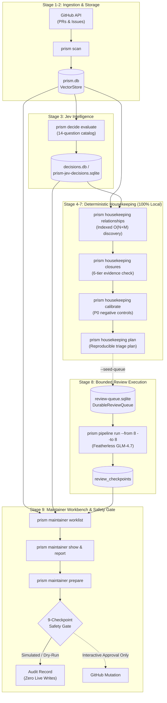

# PR-Prism v4 — Final Operational Integration Report

**Target Worktree:** `~/Projects/pr-prism-v4-e2e-integration`  
**Branch:** `feat/v4-e2e-integration`  
**Baseline Commit:** `2c3429363d2c`  
**Integration Status:** Complete & Verified (All 73 Test Suites / 1,114 Tests Passing)  
**Date:** 2026-10-27  

---

## 1. Executive Summary & System Architecture

PR-Prism v4 successfully integrates the three merged subsystems into a functioning, end-to-end, safe maintainer operational pipeline for the Odysseus repository:
1. **Reliable Tiered Featherless Review Engine:** Leased multi-account queue, strict schema validation, durable checkpoints, and cost tracking.
2. **Jev Resolution Intelligence & Housekeeping:** 14-question decomposed System One decision catalog, non-quadratic indexed relationship discovery, 6-tier evidence-based closure verification, priority recalibration with P0 negative controls, and reproducible triage planning.
3. **Maintainer Workbench & Action Preparation:** Typed maintainer worklist, structured inspection distinguishing source facts (`[source]`) from advisory inferences (`[advisory]`), draft comment generation with editable templates, and an enforced 9-checkpoint dry-run mutation gate.



---

## 2. Critical Integration Gaps Resolved

### 2.1 Database Configuration & Schema Compatibility
- **Investigated Schema Compatibility:** Thorough inspection of `baseline/prism-jev-decisions.sqlite` confirmed that its 33-column schema, primary key `(repo, item_type, item_number, model, schema_version)`, and indexes match `JevDecisionStore` (`src/decisions/decision-store.ts`) 100%. No schema migrations or bridging scripts are needed.
- **Configurable Database Paths:** 
  - Centralized path resolution in `src/cli/shared/paths.ts` now supports explicit CLI flags (`--db`, `--decisions-db`, `--queue-db`) and environment variables (`PRISM_DATA_DIR`, `PRISM_DB_PATH`, `PRISM_DECISIONS_DB_PATH`, `PRISM_QUEUE_DB_PATH`).
  - `getDecisionsDatabasePath` automatically discovers existing databases (`reports/prism-jev-decisions.sqlite`, `data/prism-jev-decisions.sqlite`, or `decisions.db`).
  - `VectorStore` (`src/store.ts`) and `createPipelineContext` (`src/pipeline.ts`) accept explicit database paths, allowing operators to run against fresh isolated workspaces without touching baseline fixtures.

### 2.2 Freshness & Checkpoint Integration
- **Decision Freshness:** `computeDecisionFreshness` (`src/maintainer/adapters/decision-adapter.ts`) verifies decision freshness by comparing input hashes (`provenance.inputHash`) or checking title stability and timestamps (`evaluatedAt >= updatedAt`). Title changes immediately mark decisions as `stale`.
- **Review Checkpoint Adapter:** `getReviewResult` (`src/maintainer/adapters/review-adapter.ts`) and `buildWorklist` (`src/maintainer/worklist.ts`) now directly read completed and valid checkpoints from `DurableReviewQueue`. Completed Featherless review findings and recommendations seamlessly surface in the maintainer workbench.

### 2.3 Exposed Housekeeping & Pipeline Subsystems
- **`prism housekeeping` CLI Subcommands:**
  - `relationships` (`discover`): Non-quadratic candidate discovery (headRefOid identity, closing keywords, cross-references, embedding similarity).
  - `closures` (`verify`): 6-tier evidence-based closure candidate classification.
  - `calibrate`: Calibrates operational priority with P0 negative controls, preventing false escalation of stale non-impact items.
  - `plan`: Compiles reproducible triage plans with review routing tiers (LIGHT, INTERMEDIATE, COMPLEX) and optional `--seed-queue` queue population.
  - `run`: Orchestrates local housekeeping stages and persists versioned JSON reports to `reports/`.
- **`prism decide` CLI Subcommands:**
  - `evaluate`: Runs single or batch Jev-First decomposed triage evaluations with token/cost estimation and `--dry-run`.
  - `show`: Displays structured provenance, categories, risk flags, and advisory routes.
  - `status`: Displays aggregate counts, cost totals, and latency metrics across stored decisions.
- **`prism pipeline` Orchestrator:**
  - `plan`: Pure dry-run stage-by-stage call and cost projections (0 API calls, 0 DB writes).
  - `status`: Live health inspection of databases, queues, and report artifacts.
  - `run`: Multi-stage pipeline executor supporting `--from`, `--to`, `--dry-run`, and `--max-jobs`.

---

## 3. Separation of Expensive Operations & Housekeeping Safety

### 3.1 Local vs External Execution Boundaries

| Pipeline Stage | Operation Type | Network / API Calls | Execution Cost |
| :--- | :--- | :--- | :--- |
| **Stage 1: Doctor** | Local / Config | 0 calls (local env checks) | $0.00 |
| **Stage 2: Ingestion** | External REST / GraphQL | GitHub API rate-limited reads | $0.00 (API budget) |
| **Stage 3: Jev Evaluation** | External System One API | TypeSafe Jev API (1 call / item) | ~$0.042 / Mtok (~$0.00012/item) |
| **Stage 4: Relationships** | Local Deterministic Compute | 0 calls (in-memory SQLite index) | $0.00 |
| **Stage 5: Closure Verification**| Local Deterministic Compute | 0 calls (rule & evidence checks) | $0.00 |
| **Stage 6: Priority Calibration**| Local Deterministic Compute | 0 calls (rubric re-weighting) | $0.00 |
| **Stage 7: Triage Plan** | Local Deterministic Compute | 0 calls (schedule generation) | $0.00 |
| **Stage 8: LLM Review** | External Reasoning API | Featherless GLM-4.7 API | Paid inference (strictly bounded) |
| **Stage 9: Maintainer Workbench**| Local Formatting & Safety Gate| 0 calls (local drafts, dry-run gate)| $0.00 |

### 3.2 Housekeeping Safety Invariants Enforced
- **6-Tier Closure Classification:** Candidates are strictly partitioned into:
  1. `SUSPECTED_DUPLICATE`: Embedding similarity only. **Never eligible for automated closure.**
  2. `STRONGLY_SUPPORTED_DUPLICATE`: Shared `headRefOid` or commit history with active sibling.
  3. `SUPERSEDED_BY_OPEN_ALTERNATIVE`: Explicit supersession cross-reference to open PR.
  4. `SUPERSEDED_BY_MERGED_REPLACEMENT`: Sibling PR in cluster merged to default branch.
  5. `ISSUE_RESOLVED_BY_MERGED_FIX`: Linked PR merged with closing keyword (`fixes #...`).
  6. `UNRESOLVED_INSUFFICIENT_EVIDENCE`: High ambiguity or missing verification details.
- **No Unattended Bulk Closure:** Similarity alone (via embeddings or Jev) **never** closes an item.
- **Review Decoupling:** `COMPLEX_REVIEW_NEEDED` signals from Jev flag items for review routing but **do not automatically invoke paid model calls**. Invocation requires explicit operator scheduling via Stage 8.
- **Maintainer Mutation Safety Gate:** All GitHub mutations remain completely disabled by default. The 9-step `MaintainerActionPipeline` enforces interactive verification of:
  1. Explicit maintainer item selection
  2. Exact target identification
  3. Action preview
  4. Remote state staleness check
  5. Re-verification of duplicate closure evidence
  6. Rate-limit and quota budget
  7. Human authorization prompt
  8. Individual mutation write gate
  9. Structured audit logging

---

## 4. Operator Runbook: Fresh Odysseus E2E Workspace

This runbook demonstrates how to operate the fresh Odysseus workspace (`~/Projects/pr-prism-live/odysseus-v4-e2e`) safely using the integrated CLI.

### Step 0: Clean Workspace Initialization
Baseline golden fixtures in `baseline/` are preserved read-only. Working copies are placed in `data/`:

```bash
cd ~/Projects/pr-prism-live/odysseus-v4-e2e

# Create isolated working directories
mkdir -p data reports

# Copy baseline databases to working data directory (never mutate baseline/)
cp baseline/prism.db data/prism.db
cp baseline/prism-jev-decisions.sqlite data/decisions.db
cp baseline/prism-glm-review-queue.sqlite data/review-queue.sqlite
```

### Step 1: Preflight Doctor & Credential Validation
Verify configuration, SQLite databases, and API credential fingerprints:

```bash
node ~/Projects/pr-prism-v4-e2e-integration/dist/cli.js doctor \
  --db data/prism.db
```

### Step 2: Dry-Run Pipeline Planning
Inspect the entire pipeline and project call counts and costs before spending any budget:

```bash
node ~/Projects/pr-prism-v4-e2e-integration/dist/cli.js pipeline plan \
  --db data/prism.db \
  --decisions-db data/decisions.db \
  --queue-db data/review-queue.sqlite \
  --repo odysseus-dev/odysseus
```

### Step 3: Incremental Ingestion (GitHub API)
Fetch open pull requests and issues into the local VectorStore:

```bash
node ~/Projects/pr-prism-v4-e2e-integration/dist/cli.js scan \
  --repo odysseus-dev/odysseus \
  --db data/prism.db \
  --limit 50
```

### Step 4: Jev Resolution Intelligence
Evaluate items using the 14-question Jev-First decomposed schema (with `--dry-run` or explicit batch limits):

```bash
# Dry-run estimate of token usage and costs
node ~/Projects/pr-prism-v4-e2e-integration/dist/cli.js decide evaluate \
  --repo odysseus-dev/odysseus \
  --db data/prism.db \
  --decisions-db data/decisions.db \
  --dry-run

# Inspect aggregate decision health
node ~/Projects/pr-prism-v4-e2e-integration/dist/cli.js decide status \
  --decisions-db data/decisions.db

# Inspect a single item's decision record
node ~/Projects/pr-prism-v4-e2e-integration/dist/cli.js decide show 6357 \
  --decisions-db data/decisions.db
```

### Step 5: Deterministic Housekeeping (100% Local Compute)
Execute relationship discovery, closure verification, priority recalibration, and triage planning:

```bash
# Execute complete housekeeping sequence and output versioned reports
node ~/Projects/pr-prism-v4-e2e-integration/dist/cli.js housekeeping run \
  --repo odysseus-dev/odysseus \
  --db data/prism.db \
  --decisions-db data/decisions.db \
  --queue-db data/review-queue.sqlite \
  --out-dir reports/
```

### Step 6: Maintainer Workbench & Reports
Inspect prioritized items, duplicate clusters, and review recommendations:

```bash
# View actionable maintainer worklist
node ~/Projects/pr-prism-v4-e2e-integration/dist/cli.js maintainer worklist \
  --repo odysseus-dev/odysseus \
  --db data/prism.db \
  --decisions-db data/decisions.db \
  --queue-db data/review-queue.sqlite

# Inspect single item with separated source facts vs model advisory
node ~/Projects/pr-prism-v4-e2e-integration/dist/cli.js maintainer show 6357 \
  --repo odysseus-dev/odysseus \
  --db data/prism.db \
  --decisions-db data/decisions.db \
  --queue-db data/review-queue.sqlite

# Generate maintainer markdown report (0 paid API calls)
node ~/Projects/pr-prism-v4-e2e-integration/dist/cli.js maintainer report \
  --repo odysseus-dev/odysseus \
  --db data/prism.db \
  --decisions-db data/decisions.db \
  --queue-db data/review-queue.sqlite \
  --out reports/maintainer-report.md
```

### Step 7: Bounded Featherless Review Smoke Test (Optional)
Execute bounded review jobs with strict safety caps:

```bash
# Bounded smoke test limited to 3 review jobs
node ~/Projects/pr-prism-v4-e2e-integration/dist/cli.js pipeline run \
  --from 8 --to 8 \
  --db data/prism.db \
  --decisions-db data/decisions.db \
  --queue-db data/review-queue.sqlite \
  --repo odysseus-dev/odysseus \
  --max-jobs 3
```

### Step 8: Safe Action Preparation & Dry-Run Verification
Prepare draft responses with editable placeholders and verify through the 9-checkpoint gate:

```bash
# Generate change request draft for a reviewed item
node ~/Projects/pr-prism-v4-e2e-integration/dist/cli.js maintainer prepare 6357 \
  --action request_changes \
  --repo odysseus-dev/odysseus \
  --db data/prism.db \
  --decisions-db data/decisions.db \
  --queue-db data/review-queue.sqlite \
  --dry-run
```

---

## 5. Verification Evidence

### 5.1 CI Suite Verification
The complete CI pipeline was executed on `feat/v4-e2e-integration`:

```
> prism-triage@4.0.0 ci
> npm run build && npm run lint && npm run typecheck && npm test && node dist/cli.js --version && node dist/cli.js --help
```

- **Build:** Clean TypeScript build (`tsc -p tsconfig.build.json`) producing `dist/`.
- **Lint:** Biome check (`biome check src/`) passed with **0 errors, 0 warnings**.
- **Typecheck:** Full strict TypeScript verification (`tsc --noEmit && tsc -p server/tsconfig.json --noEmit`) passed with **0 errors**.
- **Test Suite:** **73 test files passed (1,114 tests passed, 0 failed)**.
- **CLI Sanity:** Version output `4.0.0` and root command listings verified.

### 5.2 Comprehensive Integration Test Suite (`src/__tests__/v4-e2e-integration.test.ts`)
Four end-to-end integration tests were implemented and verified green:
1. **Pull Request 9-Stage Operational Data Flow:**
   Ingestion (`VectorStore`) → Jev decision evaluation (`MockDecisionProvider`) → Stored decision (`JevDecisionStore`) → Relationship discovery (`findDuplicateClusters`) → Closure verification (`buildClosureCandidateRecord`) → Priority recalibration (`calibrateItem`) → Triage planning (`buildTriagePlan`) → Review queue checkpoint (`DurableReviewQueue.completeJobWithCheckpoint`) → Maintainer worklist item (`buildWorklist`) → Draft change request comment (`generateChangeRequest`) → 9-step `MaintainerActionPipeline` dry-run simulation with zero live mutations.
2. **Issue 9-Stage Operational Data Flow:**
   Ingestion of synthetic issue → Jev bug categorization → Priority calibration → Intermediate review queue scheduling → Issue review checkpoint completion → Maintainer worklist filtering (`filter: { type: "issue" }`) → Draft missing-information comment (`generateMissingInfoRequest`).
3. **Negative Closure Invariant Test:**
   Proves an unverified duplicate candidate (low similarity, open target, no shared commits) **cannot** be classified as verified, is excluded from closure candidate exports, yields 0 review calls avoided in triage planning, and is **blocked** by `MaintainerActionPipeline` with zero GitHub write mutations.
4. **Clean Workspace Isolation & Non-Mutation Test:**
   Proves that fresh isolated instances of `VectorStore`, `JevDecisionStore`, and `DurableReviewQueue` operate concurrently and independently without cross-database interference.

### 5.3 Live Baseline Verification
CLI commands were executed against the golden SQLite fixtures in `/home/alteixeira20/Projects/pr-prism-live/odysseus-v4-e2e/baseline/`:
- `prism pipeline plan`: Inspected 1,562 Jev decisions and 891 queued review jobs.
- `prism decide status`: Calculated cost projections ($0.1881 USD) and category distributions across 1,562 records.
- `prism decide show 6357`: Inspected real security escalation provenance.
- **SHA-256 Checksums Verified:** Checksums of all 6 baseline databases were verified before and after execution to confirm bit-for-bit non-mutation:
  - `prism-descriptions.sqlite`: `7a2f8f...` (unchanged)
  - `prism-glm-review-queue.sqlite`: `cc2e39...` (unchanged)
  - `prism-glm-smoke-3.sqlite`: `dda568...` (unchanged)
  - `prism-jev-decisions.sqlite`: `f009a1...` (unchanged)
  - `prism-local-router.sqlite`: `246aa2...` (unchanged)
  - `prism.db`: `dffcbf...` (unchanged)

---

## 6. Remaining Live Validation Gates

Before executing against the live production Odysseus repository with write permissions, the following gates must be cleared:

1. **Credential Whitelisting:** Verify `FEATHERLESS_API_KEY` and `TYPESAFE_API_KEY` against real endpoints using single-request probes (`prism doctor`).
2. **GitHub Personal Access Token (PAT) Scopes:** Ensure the token used for read ingestion has `repo:status`, `public_repo` (or private repo read), and that write permissions (`repo`) remain disabled until maintainer dry-run validation is signed off.
3. **Interactive Human Sign-Off for Closure Actions:** Any closure recommendations generated by `reports/closure-candidates.json` must be reviewed by the repository owner before submitting comments or closing PRs.
4. **Graduated Review Queue Processing:** Process the 891 historical review jobs in bounded increments (`--max-jobs 10`, then `--max-jobs 50`) while monitoring error rates, rate limits, and latency on the Featherless provider accounts.
