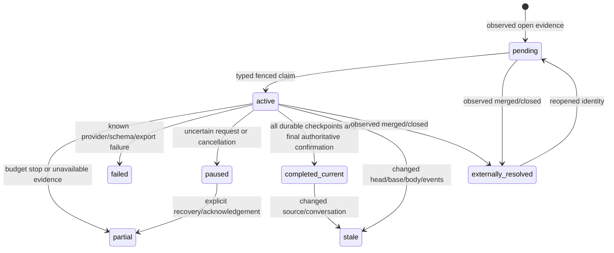

# V5 review operations design

Native TypeScript backlog operations extend the maintained V4 CLI. Single-item reviews, top-N reviews, saved drafts, scan, triage, and the embedding benchmark retain their existing routes. The acceptance report records the tested code commit and integration decision.

## CLI and local state

```sh
prism review 42 --repo example/project
prism review --all-open --repo example/project --type pr --dry-run --json
prism review --all-open --repo example/project --type pr --max-new-calls 60 --run-id batch-1
prism review --all-open --repo example/project --type pr --max-new-calls 60 --run-id batch-1 --resume
prism review --all-open --repo example/project --type issue --max-new-calls 60 --run-id issues-1
prism review --operations --status --repo example/project --type pr --json
prism review --dashboard --repo example/project --type issue --refresh 5
prism review --recover --repo example/project --type pr --json
prism review --recover --repo example/project --type pr --acknowledge-uncertain ATTEMPT_ID --json
```

`--operations-db` selects the dedicated V5 database, defaulting to `PRISM_DATA_DIR/review-operations-v5.sqlite` (`data` by default). `--queue-db` retains its V4 meaning; a V4 database is never migrated or imported. Repository and type are explicit. `--output-dir` selects immutable draft exports. No Python runner or log file is required.

`PRISM_REVIEW_ACCOUNTS` is a JSON array of one to three `{id,model,endpoint,keyEnv}` objects. Endpoints require HTTPS. Named environment variables supply credentials at execution time; secrets are never persisted. Credential-plus-provider-origin hashes provide shared account leases and detect account aliases. Operator IDs remain in the attempt ledger. Dry-run does not parse account configuration or initialize a provider. Inspection and recovery do not load credentials or access any remote service. Ambiguous legacy/new execution flags are rejected.

Execution requires an explicit nonnegative attempt budget. Resuming the same run ID requires the original budget and retains every spent reservation. A new run ID creates an additional bounded budget. No failed or uncertain reservation is refunded.

## Durable storage, compatibility and recovery

| Table | Purpose |
| --- | --- |
| `v5_jobs` | Evidence identity and original payload, operational state, owner and expiry |
| `v5_current` | Latest observed identity per repository/type/number |
| `v5_runs` | Global durable budget, charged reservations and run state |
| `v5_attempts` | Batch/model/prompt identity, outcome, result, timing and reported spend |
| `v5_leases` | Provider account single-flight lease |
| `v5_attempt_accounts` | Reservation-to-account-lease identity, including uncertain requests |
| `v5_run_scope` | Repository/type participation in global runs |
| `v5_control` | Fenced reconciliation lease |
| `v5_sync` | Reliable cursor, last full scan, last conversation probe and sync health |
| `v5_events` | Append-only operational and provider observations |

Schema 6 adds tables without changing the schema-5 job, attempt or checkpoint columns. Before upgrading a schema-5 database, SQLite `VACUUM INTO` creates a consistent uniquely named backup, including committed WAL contents. Unsupported newer schemas and non-V5 databases are refused. Read-only status never migrates or creates tables. Existing evidence, batch hashes, model/prompt fingerprints and paid counts are retained. Old PR checkpoints remain advisory until source coverage is established; inspection does not falsely count unproven legacy coverage as completed current. New source-backed evidence has a different fingerprint and preserves old history.

Claims and budget/account reservations use immediate SQLite transactions. Claims filter repository and type and prevent two live owners for different evidence versions of the same item. Reservation verifies current identity and owner before charging. WAL with synchronous FULL makes each result checkpoint atomic and durable. Fenced completion cannot overwrite a concurrently superseded job. Heartbeats extend unexpired ownership every ten seconds for a sixty-second lease. SQLite transactions are short; no network or model request holds a write lock.

Recovery distinguishes these cases:

| Interruption | Recovery |
| --- | --- |
| Before reservation | Requeue safely; no charge |
| Reservation committed, outcome not committed | Keep charge; mark `uncertain`; pause job and block its account |
| Checkpoint transaction interrupted | SQLite rolls it back; reserved request remains uncertain |
| Valid checkpoint committed | Reuse exact checkpoint after source revalidation; no repeat call |
| Draft exported, completion not committed | Treat export as pending; reuse checkpoints and revalidate before finalization |
| Completion committed, ownership not released | Clear expired ownership; retain completed state |

`--recover` is offline and never retries a paid request. Uncertain attempts require explicit `--acknowledge-uncertain ID` before retry planning; the original reservation and audit event remain. A later separately bounded execution may spend again. A timed-out or cancelled request may have reached the provider. Neither recovery nor budget accounting claims exactly-once provider execution. Known HTTP/schema failures stop that worker without paid retry. Uncertain requests also block aliased account dispatch on other jobs until acknowledgement.

## Reconciliation and races



Initial and six-hour periodic full inventories follow GitHub pagination Links, deduplicate IDs,
reject inconsistent/missing pages and scope requests to the repository. Issue inventory excludes PRs.
Two inventories bracket full scans; moving membership fails sync. Metadata-only durable records
carry `inventoryOnly` and explicit limitations. They are pending, never completed-current evidence.
Missing stored items receive a targeted metadata request rather than being inferred closed.

Other invocations use a five-minute overlap from the last reliable start cursor. Issues use the
updated `since` feed, including closed items. PRs use descending updated order and stop past the
overlap boundary. Metadata changes invalidate old evidence and preserve its history. Full evidence
is hydrated only when selected for dispatch. Before any reservation, incomplete source coverage
fails closed with zero new attempts. Failed scans preserve their reliable cursor. Rate/permission
403 and 429 responses persist a cooldown through the later of reset, Retry-After or sixty seconds;
no automatic HTTP retry or blocking sleep occurs. A new invocation respects the durable cooldown.

Previously hydrated open items receive metadata/conversation probes at full scans and every five
minutes, capped at 100 items per invocation with a durable rotating item-number cursor. With more
than 100 hydrated items, a full probe cycle needs multiple invocations; freshness remains the last
authoritative observation, not an assertion of five-minute freshness for the whole backlog. This detects comment deletion without a changed timestamp and linked PR merges. Changed
probes invalidate evidence to inventory-only pending state; they do not eagerly hydrate all sources.
Unhydrated items have no verified conversation baseline. Non-collection probes can use ETags;
collection pages are re-read. `inventoryKnown` and observation timestamps expose these limitations.
A fenced per-repository/type lease excludes competing scans.

Immediately before every new paid call, between batches, and at finalization, the complete item evidence is fetched authoritatively. Head, base, body, labels, conversation, linked PR observations, reviews and CI statuses participate in the fingerprint. Metadata and conversation are bracketed within collection; movement rejects the snapshot. Finalization rechecks after writing pending drafts. A merge in an in-flight call can consume that unavoidable attempt, but no subsequent call occurs after observed closure/change. Approval is recorded as external activity; it never substitutes for a PR-Prism review. A merged linked PR remains candidate issue evidence, not proof an issue should be closed.

GitHub has no transaction spanning a remote read and local commit. `completed_current` means current at the final successful authoritative observation; future changes are detected by reconciliation and before later calls. Status reports sync freshness rather than promising perpetual currency.

## Source evidence and complete coverage

GitHub's [PR files endpoint](https://docs.github.com/en/rest/pulls/pulls#list-pull-requests-files) has limits, and patches may be absent. V5 checks the unique paginated file count against stable PR metadata. It obtains the merge base for pinned base/head SHAs, resolves each old/new path through pinned Git commit/tree objects, and verifies [Git blob](https://docs.github.com/en/rest/git/blobs#get-a-blob) size and Git SHA-1 over its exact bytes. A bounded in-memory cache reuses immutable SHA-addressed Git objects across batches; mutable PR state and conversation are always re-read before dispatch. Only byte-preserving UTF-8 text enters the full-source contract. Symlink blobs are read without following their targets. File paths, rename history, modes, source hashes and original patch hashes form a checksummed manifest.

For each available text change the model receives the original unmodified patch plus complete old/new source, including deletions and empty additions. Thus a missing or truncated patch can be fully covered through its verified sources. Available source text is never silently shortened. Each serialized file is divided into bounded exact character spans with hashes and offsets; the assembled spans reproduce the complete source record. The metadata batch includes every changed filename, status and object SHA.

Binary, non-UTF-8, submodule, inaccessible, oversized API objects, truncated trees and incomplete file inventories remain explicit coverage limitations. Such reviews can be partial, never completed current. Completion requires manifest validation, checksummed source coverage for every changed file, every matching durable batch checkpoint, and stable final source confirmation. Findings refer to exact evidence hashes, file paths and character offsets. They remain unverified claims requiring source/test confirmation; no model verdict authorizes action.

## Exports and inspection

Synced temporary files and atomic create-only links publish uniquely named JSON and Markdown drafts. Directory entries are synced. Checkpoints in SQLite are authoritative. An export explicitly says `pending_final_confirmation`; only database state establishes current/stale status. A crash can leave an orphan draft, but it cannot establish completed coverage. Publication requires a filesystem supporting these atomic operations; export failure fails closed.

Status and dashboard share one deferred read-transaction snapshot and never claim, recover, migrate or invoke providers. Non-TTY/JSON emits one snapshot and exits. TTY refresh respects terminal width/height and redraws on resize; Ctrl+C only removes dashboard timers/listeners. WAL readers coexist with workers. Displays include open/current/missing/stale counts, incomplete/failed/paused state, active item/batch/account, charged/uncertain requests and remaining budget, throughput, sync/rate health and external resolution.

ETA uses last-hour completed evidence characters divided by observed elapsed time, incorporating concurrency and batch size. Fewer than three timed samples yield N/A. Backlog and bounded-run ETA are separate; the latter is limited by relevant remaining budgets. Indicative 0.5x–2x ranges are explicitly estimates, not statistical confidence intervals. They exclude unavailable evidence, future changes and provider/reporting gaps. Spend is shown only when reported; absent cost data is never represented as zero cost.

## Privacy and future writes

The GitHub transport exposes GET only. JSON-framed untrusted evidence stays separate from system instructions. Output validation has no executable action fields. This is a containment measure, not proof of model injection immunity. No live production artifacts are imported. Source verification, read-only polling and local drafts do not post, approve, close, edit contributor branches or merge. Future writes and historical imports require separately authorized work and independent source/CI/repository-rule checks. The import plan remains offline and reversible.
