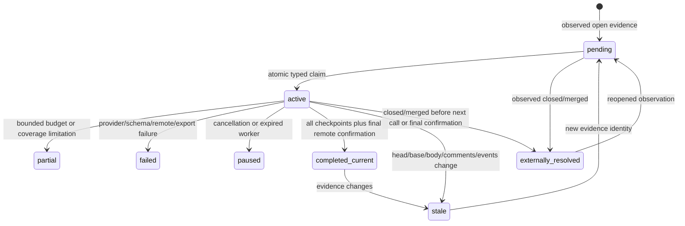

# V5 review operations design

This branch adds native TypeScript backlog operations to the maintained V4 source. Existing single-item, top-N, saved-review, scan, triage and embedding benchmark paths remain registered. This implementation is a reviewable development increment; acceptance is NO-GO for future fork-main consolidation until the limitations in the acceptance report are resolved.

## CLI

Existing examples: `prism review 42 --repo example/project`, `prism review --top 5`, `prism review --show 42`. V5 examples:

```sh
prism review --all-open --type pr --repo example/project --dry-run --json
prism review --all-open --type pr --repo example/project --max-new-calls 60 --run-id batch-1
prism review --all-open --type pr --repo example/project --max-new-calls 60 --run-id batch-1 --resume
prism review --all-open --type issue --repo example/project --max-new-calls 60 --run-id issues-1
prism review --status --type pr --repo example/project --json
prism review --dashboard --type issue --repo example/project --refresh 5
```

`--operations-db` selects a dedicated V5 SQLite database. The default is `PRISM_DATA_DIR/review-operations-v5.sqlite`, with `data` as the default data directory. `--queue-db` retains its legacy V4 meaning and must not be used to select a V5 file. Explicit `--repo` avoids accidental cross-repository operations. Output defaults to the data directory's `review-operations-drafts` subdirectory. No Python dependency or log file is required.

Accounts use `PRISM_REVIEW_ACCOUNTS`, a JSON array of one to three `{id,model,endpoint,keyEnv}` objects. Endpoints require HTTPS; credentials are read from the named environment variables. Account IDs must identify distinct provider accounts consistently across processes. Dry-run does not parse account configuration or instantiate a paid provider. An explicit attempt budget is mandatory for execution. New budget identities permit additional calls; resuming an existing identity retains its original spent count and requires the same budget.

## Storage and invariants

V5 never opens or migrates a V4 queue. A nonempty SQLite file without V5 tables is refused. Fresh databases use WAL and schema version 5; old queue/checkpoint schemas remain interpretable by V4. An offline import is planned separately.

| Table | Purpose |
| --- | --- |
| `v5_jobs` | Immutable evidence identity, repository, type, number, full evidence snapshot, operational state and worker ownership |
| `v5_current` | One authoritative observed evidence identity per repository/type/number, including closed items |
| `v5_runs` | Durable global budget and spent reservations by caller-selected run ID |
| `v5_attempts` | One ledger row per charged reservation; batch/model/prompt identity, outcome, timing and optional spend |
| `v5_leases` | Global account single-flight ownership and expiry |
| `v5_sync` | Latest full reconciliation observation and reliability flag |
| `v5_events` | Append-only observed provider/operational events |

Claims use `BEGIN IMMEDIATE` and filter repository and item type inside SQL. A PR worker cannot claim issue jobs. Budget reservations and account leases are committed in the same immediate transaction before model dispatch. Reservations are never refunded after cancellation, uncertainty or crash: conservative counting prevents overbilling. Multiple processes must share the same database and run identity for one global budget. A database-wide worker cap of at most three and per-account single-flight leases apply across run IDs. Ten-second heartbeats renew sixty-second ownership while work is active. Expired work is paused for operator recovery, retaining charged attempts and valid checkpoints. There is no automatic retry or recovery of uncertain dispatches.

Checkpoint reuse requires exact job evidence hash, batch hash and model/endpoint/prompt fingerprint. Provider errors and invalid schemas fail the worker without retry. Results cannot express executable actions. Batch outputs are unverified claims with mandatory uncertainty, exact file/evidence hash and character offsets. These offsets refer to unchanged supplied evidence; unified diff hunk headers retain original source line context. Prompt instructions use a separate system message; evidence is JSON-framed untrusted data. This limits instruction ambiguity but cannot prove a model is immune to injection.

## Reconciliation



REST inventory follows pagination Link headers, scopes to one repository, deduplicates IDs, excludes PR records from issue inventory, detects conflicting duplicates, repeated cursors, empty intermediate pages and HTTP errors. Missing items are fetched authoritatively rather than inferred closed. Two complete inventory enumerations bracket reconciliation; moving membership marks the sync unreliable. This increment uses full reconciliation on every invocation, not overlapping incremental windows. A failed sync blocks execution. GitHub is not a transactionally consistent database: freshness is an observation, never a guarantee that no state changed after it.

Full metadata, conversation, timeline, PR files, reviews and commit statuses are fetched before each dispatch and at final completion. Changed metadata during a fetch aborts it. Head and base are part of evidence identity, along with raw patches and conversation/events. A merge during a call may still consume that unavoidable in-flight attempt; no subsequent batch is sent after observed closure or supersession. Old evidence and results remain historical. Approval is recorded but does not automatically suppress review. Linked fixes and duplicate allegations remain candidates; issue closure requires independent verification.

## Evidence, exports and dashboard

Text patches are divided into bounded exact character spans per file with hash/offset coverage manifests; no supplied characters are dropped. Hunk text is retained even when a very large hunk spans batches. Binary/unavailable patches and incomplete file inventories remain explicit limitations. REST patches cannot prove complete source diff coverage, so current real-provider PR runs remain `partial` even after all text batches. A future source-backed raw diff verification adapter must close this gap before asserting full coverage.

Each final draft uses a unique immutable basename, synced temporary files and atomic create-only links for JSON and readable Markdown. SQLite remains the checkpoint authority if export fails. Two-file export is not transactional; orphan JSON after a crash is harmless and must not be interpreted as completed review. Local reports include source evidence hashes and unverified recommendation blockers. No raw model response logs or live artifacts enter Git.

Status and dashboard share `OperationsStore.snapshot`. Missing state is reported as uninitialized without creating a database. Read-only connections never migrate or claim work. Non-TTY and `--json` output one machine-readable snapshot and exit. TTY refresh uses the current terminal dimensions naturally through terminal redraw; Ctrl+C removes only its timer/listener. Snapshot counts separate latest evidence from historical stale jobs. Snapshot generation uses one deferred read transaction so its counts and ledger share the same SQLite observation.

ETA is labeled estimated and uses observed completed batch latency after at least three timed batches. Insufficient throughput yields N/A. Backlog ETA estimates remaining known evidence batches; bounded-stop ETA uses remaining observed budgets. Estimates are serial, exclude unknown source evidence and future changes, and require refinement for variable batch complexity and concurrently active run budgets. Source sync observations include rate-limit headers in persisted evidence. Rich per-model cost summaries and active batch TTY presentation remain incomplete.

## Privacy and future writes

This subsystem's GitHub transport exposes GET only. Its model schema has no executable action fields. Future posting, contributor edits, branch changes, closures, approvals or merges need a separate opt-in implementation with explicit item confirmation, fresh head/base/CI/review/rule checks and audit. No such write path exists in V5 operations. Existing unrelated V4 maintainer features retain their own gates. Live runner databases, logs, overnight/targeted drafts, installed releases, global packages, fork main and upstream are outside this branch's write scope.
